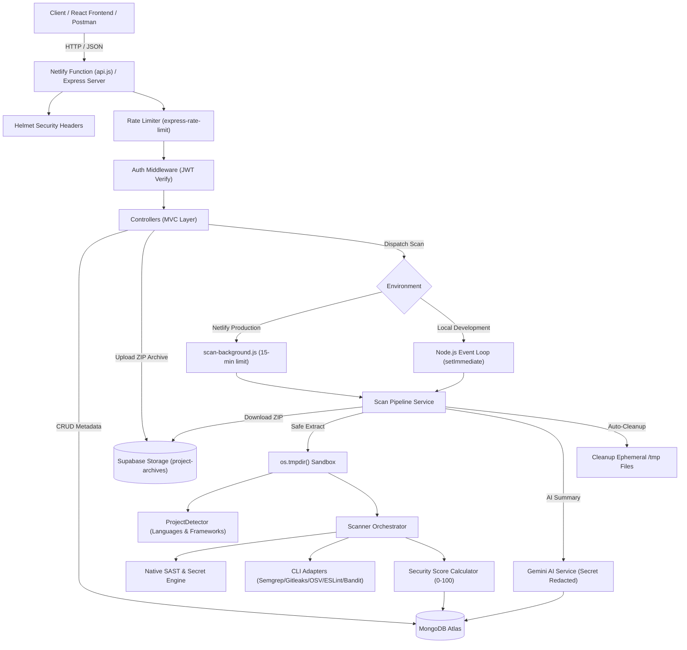
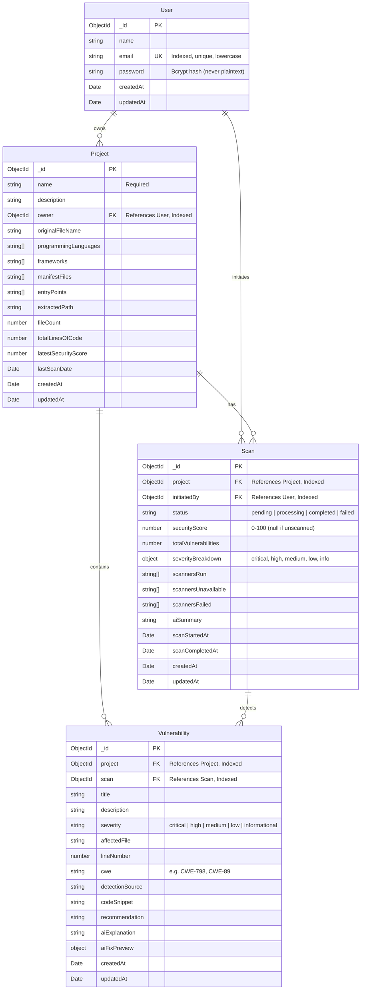

# AEGISOR

> **Rule Out Every Vulnerability.**  
> Intelligent Code Security Auditing and Automated Vulnerability Assessment Platform.

[](https://nodejs.org/)
[](https://www.mongodb.com/atlas)
[](https://expressjs.com/)
[](LICENSE)
[](#18-current-development-progress)

---

## Table of Contents

1. [Project Overview and Purpose](#1-project-overview-and-purpose)
2. [Problem Statement](#2-problem-statement)
3. [Key Features](#3-key-features)
   - [Implemented Backend Features](#implemented-backend-features)
   - [Planned Features (Frontend & Integrations)](#planned-features-frontend--integrations)
4. [Technology Stack](#4-technology-stack)
5. [Complete Project Folder Structure](#5-complete-project-folder-structure)
6. [System Architecture and Workflow](#6-system-architecture-and-workflow)
7. [Frontend Documentation](#7-frontend-documentation)
8. [Backend Architecture & Services](#8-backend-architecture--services)
9. [Database Architecture and Relationships](#9-database-architecture-and-relationships)
10. [Complete REST API Specification](#10-complete-rest-api-specification)
11. [Authentication and Security Implementation](#11-authentication-and-security-implementation)
12. [Secure ZIP Upload & Extraction Engine](#12-secure-zip-upload--extraction-engine)
13. [Programming Language & Framework Detection](#13-programming-language--framework-detection)
14. [Modular Security Scanning Engine](#14-modular-security-scanning-engine)
15. [AI-Powered Analysis & Secret Redaction (Gemini API)](#15-ai-powered-analysis--secret-redaction-gemini-api)
16. [Security Score Algorithm](#16-security-score-algorithm)
17. [PDF Audit Report Generation](#17-pdf-audit-report-generation)
18. [Current Development Progress](#18-current-development-progress)
19. [Installation and Setup Instructions](#19-installation-and-setup-instructions)
20. [Environment Variables](#20-environment-variables)
21. [How to Run the Project Locally](#21-how-to-run-the-project-locally)
22. [Testing Suite & Verification Instructions](#22-testing-suite--verification-instructions)
23. [Known Limitations, Deployment Constraints & Pending Work](#23-known-limitations-deployment-constraints--pending-work)
24. [Future Roadmap](#24-future-roadmap)
25. [Team Contribution Guidelines](#25-team-contribution-guidelines)

---

## 1. Project Overview and Purpose

**AEGISOR** is an AI-powered code security and project auditing platform engineered to allow software developers, engineering leads, and security auditors to upload complete project source code repositories (as ZIP files) for automated, multi-engine security inspection.

### Core Objectives:
- **Rule Out Vulnerabilities:** Identify critical security flaws (SQL injection, Command Injection, XSS, RCE, broken cryptography, unvalidated input).
- **Detect Leaked Secrets & Credentials:** Expose hardcoded API keys, private keys, database URIs, and webhook URLs before they reach production.
- **Audit Open Source Dependencies (SCA):** Detect known malicious or vulnerable third-party packages in `package.json`, `requirements.txt`, etc.
- **Explain Risks in Plain Language:** Use Google Gemini AI to translate complex security defects into beginner-friendly explanations with actionable remediation steps.
- **Provide AI Fix Previews:** Deliver before-and-after unified code diffs showing developers exactly how to patch vulnerabilities safely.
- **Deliver Executive Reports:** Generate downloadable, publication-grade PDF audit reports with security scores, severity scorecards, and developer guidelines.

---

## 2. Problem Statement

Modern software development moves rapidly, frequently introducing third-party dependencies, complex multi-tier architectures, and microservices. However, traditional security auditing approaches face significant hurdles:

- **Manual Code Reviews are Slow and Costly:** Security teams cannot review every pull request manually without introducing significant delivery bottlenecks.
- **High Noise-to-Signal Ratio in Traditional Scanners:** Legacy static application security testing (SAST) tools generate voluminous false positives that desensitize developers.
- **Lack of Actionable Context:** Many tools report vulnerabilities (e.g., "SQL Injection detected") without actionable code-level context or automated suggestions on how to remediate the flaw within the specific framework in use.
- **Fragmented Tooling:** Developers must juggle separate linters, secret scanners, dependency checkers, and container auditors.

**AEGISOR** unifies these disparate tools into a single, cohesive auditing platform that automates static analysis, dependency checking, credential detection, scorecards, AI explanations, and reporting.

---

## 3. Key Features

### Implemented Backend Features
- **Complete User Authentication & Lifecycle:**
  - Secure registration, login, and profile fetching.
  - Profile updates (name, email with duplicate detection).
  - Secure password changes with old-password verification.
  - Permanent account deletion with complete cascade cleanup of all projects, scans, findings, and uploaded files.
  - JWT Bearer token authentication with configurable expiry (`7d` default).
  - Bcrypt salted one-way hashing (10 rounds).
- **Project Management System:**
  - Full CRUD operations for projects.
  - Strict ownership isolation: clients can never access or modify another user's projects.
  - Pagination, sorting (newest first), and project metadata storage.
- **Secure ZIP File Upload System:**
  - Multipart upload support via Multer with 50MB default limit.
  - Strict file signature (magic byte) validation (`PK\x03\x04`).
  - Bulletproof **Zip Slip** defense (rejects all `..` path traversal sequences).
  - Comprehensive **Zip Bomb** defenses (max entry limits, uncompressed size ceilings, compression ratio thresholds).
  - Safe, non-executable extraction into isolated temporary workspaces.
  - Immediate cleanup of uploaded temporary archive files.
- **Automated Language & Framework Detection:**
  - Inspects file extensions for JavaScript, TypeScript, Python, Java, C, C++, PHP, HTML, CSS, Go, Rust, Ruby, and Shell.
  - Detects frameworks: Express.js, React, Next.js, Vue, Angular, NestJS, Django, Flask, FastAPI, Spring Boot, etc.
  - Identifies dependency manifests (`package.json`, `requirements.txt`, etc.) and candidate entry points (`server.js`, `app.py`, etc.).
  - Calculates line count and file counts.
- **Modular Multi-Engine Security Scanner:**
  - **Native SAST & Secret Engine:** Built-in, zero-dependency rules detecting AWS keys, private keys, database connection strings, GitHub tokens, Slack webhooks, SQL injection, Command injection, Eval/RCE, DOM XSS, and weak TLS configurations.
  - **Modular External Adapters:** Integrated adapters for Semgrep, Gitleaks, OSV-Scanner, ESLint, and Bandit with automatic environment availability detection.
  - **Scanner Orchestrator:** Normalizes heterogeneous findings into standardized CWE-indexed records and eliminates duplicates.
- **Deterministic Security Scoring Algorithm:**
  - Calculates a 0–100 score based on severity deductions (-25 Critical, -15 High, -7 Medium, -2 Low).
  - Clearly distinguishes unscanned projects (`null`) from critically vulnerable projects (`0`).
- **AI-Powered Analysis (Gemini API Integration):**
  - Beginner-friendly vulnerability explanations.
  - Automatic secret redaction: sanitizes AWS keys, tokens, and credentials before sending context to AI.
  - AI Fix Preview generating before-and-after unified code diffs (read-only, never modifies source code).
  - Automated executive scan summaries.
  - Graceful degradation: all scanning and platform features work fully when `GEMINI_API_KEY` is not configured.
- **PDF Audit Report Generation:**
  - Professional, branded audit report PDFs generated using `pdfkit`.
  - Includes score badge, letter grades (A–F), severity breakdowns, findings list, and remediation instructions.
  - Secure downloads restricted strictly to the project owner.
- **Executive Dashboard Metrics:**
  - Centralized overview endpoint (`GET /api/dashboard/overview`) delivering project counts, scan lifecycle states, average scores, severity distribution, and recent activity.
- **Hardened Production Middleware:**
  - Security headers powered by `helmet`.
  - Configurable CORS policy.
  - Rate limiting (general API limit + strict brute-force limits on `/api/auth`).
  - Centralized error handling and safe request logging.
  - Graceful server shutdown on `SIGINT` and `SIGTERM`.

### Planned Features (Frontend & Integrations)
- **Frontend Dashboard (Phase M):** React.js single-page application with modern UI for project creation, archive drag-and-drop, interactive vulnerability inspection, and PDF downloading.
- **CI/CD Integrations:** GitHub Actions and GitLab CI runners for automated PR security checks.
- **Real-Time Scan Progress:** WebSockets/Server-Sent Events (SSE) for live scan status streaming.

---

## 4. Technology Stack

### Backend Core
| Technology | Version | Purpose |
|---|---|---|
| **Node.js** | `^26.x` | JavaScript asynchronous server runtime |
| **Express.js** | `^5.3.0` | HTTP web server and REST routing engine |
| **MongoDB Atlas** | Cloud | Document-based persistence store |
| **Mongoose** | `^9.12.0` | Object Data Modeling (ODM) with schema validation and indexing |

### Security, Auth & Uploads
| Package | Version | Purpose |
|---|---|---|
| **jsonwebtoken** | `^9.0.3` | Cryptographic JWT token issuance and verification |
| **bcrypt** | `^6.0.0` | Salted one-way password hashing (10 rounds) |
| **multer** | `^2.5.0` | Secure multipart/form-data ZIP file uploads |
| **adm-zip** | `^0.6.1` | High-performance ZIP parsing, signature checks, and safe extraction |
| **helmet** | `^8.3.0` | HTTP security headers (XSS, HSTS, CSP, Sniff protection) |
| **cors** | `^2.8.6` | Cross-Origin Resource Sharing control |
| **express-rate-limit** | `^8.7.3` | DDoS and brute-force mitigation |

### AI & Reporting
| Package | Version | Purpose |
|---|---|---|
| **@google/genai** | `^3.0.0` | Official Google GenAI SDK for Gemini 2.5 Flash analysis |
| **pdfkit** | `^0.20.2` | Vectorized PDF document generation |
| **dotenv** | `^18.0.9` | Environment variable isolation |

---

## 5. Complete Project Folder Structure

```
AEGISOR/
│
├── .gitignore                      # Root Git ignore rules (node_modules, .env, build, uploads)
├── README.md                       # Comprehensive living project documentation
│
├── backend/                        # Complete Express & Node.js backend
│   ├── .env                        # Local environment secrets (IGNORED BY GIT)
│   ├── .env.example                # Safe environment variable template with placeholders
│   ├── .gitignore                  # Backend-specific ignore rules
│   ├── package.json                # Backend dependency definitions & test scripts
│   ├── package-lock.json           # Locked dependency tree
│   ├── server.js                   # Main application entry point, middleware & listener
│   │
│   ├── config/                     # Configuration modules
│   │   └── db.js                   # Mongoose MongoDB Atlas connection handler
│   │
│   ├── controllers/                # Request handlers & business logic
│   │   ├── authController.js       # Register, login, profile, password, account deletion
│   │   ├── projectController.js    # Project CRUD operations & owner verification
│   │   ├── uploadController.js     # ZIP upload, signature check & safe extraction
│   │   ├── scanController.js       # Scan execution, status polling & PDF download
│   │   ├── vulnerabilityController.js # Vulnerability queries, AI explain, fix previews
│   │   └── dashboardController.js  # Aggregated metrics, scores, and activity logs
│   │
│   ├── middleware/                 # Custom Express middleware
│   │   ├── authMiddleware.js       # JWT Bearer token validation & req.user attachment
│   │   ├── uploadMiddleware.js     # Multer disk upload with size & type limits
│   │   └── errorHandler.js         # Centralized API error handling
│   │
│   ├── models/                     # Mongoose data schemas
│   │   ├── User.js                 # User credentials & timestamps
│   │   ├── Project.js              # Project metadata, frameworks, file statistics
│   │   ├── Scan.js                 # Scan status, score, severity breakdown, tool stats
│   │   └── Vulnerability.js        # Discovered findings, CWEs, snippets, AI explanations
│   │
│   ├── routes/                     # REST API route declarations
│   │   ├── authRoutes.js           # /api/auth routes
│   │   ├── projectRoutes.js        # /api/projects routes & upload/scan mount points
│   │   ├── scanRoutes.js           # /api/scans/:id endpoints
│   │   ├── vulnerabilityRoutes.js  # /api/vulnerabilities/:id endpoints
│   │   └── dashboardRoutes.js      # /api/dashboard endpoints
│   │
│   ├── services/                   # Modular domain services
│   │   ├── ai/
│   │   │   └── geminiService.js    # Gemini API client, secret redaction, AI fix diffs
│   │   ├── detector/
│   │   │   └── projectDetector.js  # Language, framework, and entry point detection
│   │   ├── reports/
│   │   │   └── pdfReportService.js # PDFKit report generation engine
│   │   ├── scanners/
│   │   │   ├── scannerOrchestrator.js # Multi-engine coordinator & scoring calculator
│   │   │   ├── adapters/
│   │   │   │   ├── builtInScannerAdapter.js # Native SAST & Secret Scanner
│   │   │   │   ├── semgrepAdapter.js        # Semgrep CLI adapter
│   │   │   │   ├── gitleaksAdapter.js       # Gitleaks CLI adapter
│   │   │   │   ├── osvScannerAdapter.js     # OSV-Scanner CLI adapter
│   │   │   │   ├── eslintAdapter.js         # ESLint CLI adapter
│   │   │   │   └── banditAdapter.js         # Bandit CLI adapter
│   │   │   └── utils/
│   │   │       └── cliChecker.js            # Cross-platform CLI presence checker
│   │   └── uploads/
│   │       └── zipService.js       # Magic byte validation, Zip Slip & Bomb defenses
│   │
│   ├── tests/                      # Automated test suite
│   │   ├── runModularUnitTests.js  # 28-point core engine & security unit test suite
│   │   └── runMasterTestSuite.js   # Full end-to-end integration test runner
│   │
│   ├── utils/                      # Utilities
│   │   └── generateToken.js        # JWT token generation
│   │
│   └── uploads/                    # Controlled staging directory (git-ignored)
│       ├── temp/                   # Temporary upload holding directory
│       └── projects/               # Extracted project files (isolated per project)
│
├── docs/                           # Documentation specifications (reserved)
├── frontend/                       # React frontend application (scaffolded directory)
├── scanners/                       # External scanner rules directory
└── uploads/                        # Root upload directory (git-ignored)
```

---

## 6. System Architecture and Workflow

### Platform Architecture



---

## 7. Frontend Documentation

> **Status:** Scaffolded directory (`frontend/`). Awaiting frontend implementation in the upcoming development phase.

### Planned Architecture:
- **Framework:** React.js (SPA) with Vite.
- **State Management:** React Context API or lightweight stores for auth session, active project, and real-time scan progress.
- **Planned Pages & Views:**
  1. `Authentication`: Login, Register, Profile Management.
  2. `Dashboard`: Live security metrics, project cards, severity breakdown charts.
  3. `Project Manager`: Repository creation, archive drag-and-drop uploader.
  4. `Scan Details & Audit`: Code browser highlighting vulnerability lines, severity filters, AI explain dialogs, and before-and-after fix diff previews.
  5. `Report Center`: One-click PDF audit report generation and download.

---

## 8. Backend Architecture & Services

The backend is built around a decoupled **Model-View-Controller (MVC) + Services** pattern, engineered for dual-mode execution (standalone Node.js server or Netlify Serverless Functions):

1. **Application Layer (`backend/app.js`):**
   - Pure Express application initialization separated from HTTP transport listeners.
   - Registers Helmet security headers, CORS origin filtering, reverse proxy trust (`trust proxy`), dual-tier rate limiters, request loggers, and centralized error handling.
   - Mounts REST API routes under `/api/*` and root health check at `/`.
2. **Server Transport (`backend/server.js`):**
   - Standalone Node.js entry point for local development and non-serverless container environments.
   - Connects to MongoDB Atlas via `connectDB()`, binds to `PORT`, and handles graceful shutdown (`SIGINT`, `SIGTERM`).
3. **Serverless Function Entry (`netlify/functions/api.js` & `backend/functions/api.js`):**
   - Serverless adapter using `serverless-http` wrapping `app.js`.
   - Reuses warm MongoDB connection pools by disabling `context.callbackWaitsForEmptyEventLoop`.
   - Provides intelligent path normalization bridging Netlify rewrites (`/.netlify/functions/api/*`) with Express route trees.
4. **Controllers (`backend/controllers/`):** Pure HTTP boundary handlers. Validate incoming inputs, enforce project ownership, call services, and return standardized JSON.
5. **Services (`backend/services/`):**
   - `uploads/zipService.js`: Encapsulates archive security validation and safe extraction.
   - `detector/projectDetector.js`: Scans extracted project trees to detect languages, frameworks, and manifests.
   - `scanners/scannerOrchestrator.js`: Dispatches scans across built-in and external engines, aggregates findings, and calculates security scores.
   - `ai/geminiService.js`: Interacts with Google GenAI SDK with sanitization, secret redaction, and fallback handling.
   - `reports/pdfReportService.js`: Streams formatted PDF reports.
6. **Middleware (`backend/middleware/`):**
   - `authMiddleware.js`: Extracts and verifies JWT Bearer tokens; loads user without password.
   - `uploadMiddleware.js`: Handles multipart uploads with file size and MIME-type limits, with automatic serverless `/tmp` fallback.
   - `errorHandler.js`: Intercepts Mongoose errors, CastErrors, duplicate key collisions, and uncaught exceptions.
7. **Database Connection (`backend/config/db.js`):**
   - Global connection pooling and promise caching across serverless function warm starts.
   - Automatically reuses open connections (`readyState === 1`) and resolves in-flight connection promises (`readyState === 2`).

---

## 9. Database Architecture and Relationships

The database is powered by **MongoDB Atlas** using **Mongoose Schemas**.



---

## 10. Complete REST API Specification

**Base URL:** `http://localhost:5000`

### Health Check
| Method | Endpoint | Access | Description | Status Code |
|---|---|---|---|---|
| `GET` | `/` | Public | Returns API version, status, and database state | `200 OK` |

### Authentication Routes (`/api/auth`)
| Method | Endpoint | Access | Description | Success Code | Error Codes |
|---|---|---|---|---|---|
| `POST` | `/api/auth/register` | Public | Register new account, hash password, return JWT | `201 Created` | `400`, `409`, `500` |
| `POST` | `/api/auth/login` | Public | Authenticate credentials and return JWT | `200 OK` | `400`, `401`, `500` |
| `GET` | `/api/auth/me` | Private | Retrieve authenticated user profile | `200 OK` | `401`, `500` |
| `PUT` | `/api/auth/profile` | Private | Update user name and/or email | `200 OK` | `400`, `409`, `500` |
| `PUT` | `/api/auth/password` | Private | Change password (verifies current password) | `200 OK` | `400`, `401`, `500` |
| `DELETE` | `/api/auth/account` | Private | Permanently delete account and cascade delete all data | `200 OK` | `400`, `401`, `500` |

### Project Management Routes (`/api/projects`)
| Method | Endpoint | Access | Description | Success Code | Error Codes |
|---|---|---|---|---|---|
| `POST` | `/api/projects` | Private | Create new project (`name`, `description`) | `201 Created` | `400`, `401`, `500` |
| `GET` | `/api/projects` | Private | List user's projects (supports `?page=1&limit=10`) | `200 OK` | `401`, `500` |
| `GET` | `/api/projects/:id` | Private | Retrieve single project (verifies ownership) | `200 OK` | `400`, `403`, `404` |
| `PUT` | `/api/projects/:id` | Private | Update project name or description | `200 OK` | `400`, `403`, `404` |
| `DELETE` | `/api/projects/:id` | Private | Delete project, cascade delete scans, findings & files | `200 OK` | `400`, `403`, `404` |
| `POST` | `/api/projects/:id/upload` | Private | Upload & store project ZIP (Supabase private bucket / local) | `200 OK` | `400`, `403`, `404`, `502` |
| `GET` | `/api/projects/:id/archive` | Private | Generate signed URL for private archive download | `200 OK` | `400`, `403`, `404` |
| `POST` | `/api/projects/:id/scans` | Private | Trigger asynchronous security scan for project | `202 Accepted` | `400`, `403`, `404` |
| `GET` | `/api/projects/:id/scans` | Private | List all scans for project (newest first) | `200 OK` | `400`, `403`, `404` |
| `GET` | `/api/projects/:id/vulnerabilities`| Private | Query project findings (filters: `?severity=&scanId=`) | `200 OK` | `400`, `403`, `404` |

### Scan & Reporting Routes (`/api/scans`)
| Method | Endpoint | Access | Description | Success Code | Error Codes |
|---|---|---|---|---|---|
| `GET` | `/api/scans/:id` | Private | Retrieve scan details, score, and tool status | `200 OK` | `400`, `403`, `404` |
| `GET` | `/api/scans/:id/status` | Private | Poll scan status & auto-reconcile stale scans | `200 OK` | `400`, `403`, `404` |
| `GET` | `/api/scans/:id/results` | Private | Get all vulnerabilities discovered in scan | `200 OK` | `400`, `403`, `404` |
| `GET` | `/api/scans/:id/report` | Private | Download publication-grade PDF audit report | `200 OK (PDF)`| `400`, `403`, `404` |

### Vulnerability & AI Analysis Routes (`/api/vulnerabilities`)
| Method | Endpoint | Access | Description | Success Code | Error Codes |
|---|---|---|---|---|---|
| `GET` | `/api/vulnerabilities/:id` | Private | Retrieve single vulnerability with code context | `200 OK` | `400`, `403`, `404` |
| `POST` | `/api/vulnerabilities/:id/explain` | Private | Generate AI beginner-friendly explanation | `200 OK` | `400`, `403`, `404` |
| `POST` | `/api/vulnerabilities/:id/fix-preview` | Private | Generate AI fix recommendation & unified diff | `200 OK` | `400`, `403`, `404` |

### Dashboard Overview Routes (`/api/dashboard`)
| Method | Endpoint | Access | Description | Success Code | Error Codes |
|---|---|---|---|---|---|
| `GET` | `/api/dashboard/overview` | Private | Overall metrics, scores, severity breakdown & activity | `200 OK` | `401`, `500` |

---

## 11. Authentication and Security Implementation

- **Bcrypt Password Hashing:** Salt rounds set to 10; passwords hashed before database insertion. Plaintext passwords never stored.
- **Password Exclusion:** Password hashes are strictly omitted from Mongoose responses via `.select('-password')`.
- **JWT Authorization:** Tokens signed using HMAC-SHA256 (`jwt.sign`) with `JWT_SECRET` and expiration (`JWT_EXPIRES_IN=7d`).
- **Owner Verification:** All project, scan, and vulnerability endpoints verify that the resource's `owner` or `initiatedBy` matches `req.user._id`.
- **Cascade Deletion:** Account deletion completely removes all associated projects, scans, vulnerability records, and temporary files from disk.

---

## 12. Secure ZIP Upload & Extraction Engine

The file ingestion engine enforces enterprise-grade archive security:

1. **MIME & Extension Whitelisting:** Accepts only files with `.zip` extension and appropriate MIME types.
2. **Magic Byte Signature Verification:** Validates the first 4 bytes of every file. Must match standard ZIP signatures (`0x50 0x4B 0x03 0x04` or `0x50 0x4B 0x05 0x06`). Spoofed `.zip` files (e.g. executables renamed to `.zip`) are immediately rejected.
3. **Zip Slip Defense:** Every entry's relative name is checked for `..` sequences. In addition, the resolved destination path is strictly validated:
   ```javascript
   if (!resolvedPath.startsWith(resolvedTarget + path.sep)) {
     throw new Error("Path traversal attempt detected");
   }
   ```
4. **Zip Bomb Protection:**
   - Maximum entry count: 3,000 files.
   - Maximum uncompressed size: 150MB.
   - Compression ratio ceiling: Maximum 100:1 ratio.
5. **Inert Storage:** Files are written with non-executable permissions (`0o644`). Uploaded code is **never** executed, compiled, or run on the server.
6. **Automatic Cleanup:** Uploaded temporary archive files are unlinked immediately after extraction.

---

## 13. Programming Language & Framework Detection

Upon safe extraction, `projectDetector.js` recursively inspects the source tree:
- **Languages:** Evaluates file extensions and ranks detected languages by file count.
- **Frameworks:** Intelligently parses `package.json` dependencies (Express, React, Next.js, Vue, NestJS, etc.) and `requirements.txt` (Django, Flask, FastAPI).
- **Manifests & Entry Points:** Catalogs package manifests (`package-lock.json`, `pom.xml`, `build.gradle`, etc.) and entry point files (`server.js`, `main.py`, `app.js`, `index.html`).
- **Statistics:** Quantifies total files and lines of code.

---

## 14. Modular Security Scanning Engine

AEGISOR employs an orchestrator pattern coordinating multi-engine security scans:

### 1. AEGISOR Native Engine (Always Active)
Zero-dependency, high-speed static analysis engine checking code files line-by-line:
- **Exposed AWS Credentials:** `AKIA...` (CWE-798, Critical)
- **Hardcoded Database URIs:** Plaintext connection strings (CWE-798, Critical)
- **Exposed Private Keys:** Embedded RSA/EC private keys (CWE-798, Critical)
- **GitHub / Slack Tokens:** Leaked developer tokens (CWE-798, High/Critical)
- **SQL Injection:** String concatenation in database queries (CWE-89, High)
- **Command Injection:** Unsanitized shell execution (CWE-78, Critical)
- **Dynamic Code Execution:** `eval()`, `new Function()` (CWE-95, High)
- **DOM Cross-Site Scripting (XSS):** Unsanitized `innerHTML` (CWE-79, High)
- **Broken Cryptography:** MD5/SHA-1 usage (CWE-328, Medium)
- **Disabled TLS:** `NODE_TLS_REJECT_UNAUTHORIZED='0'` (CWE-295, High)
- **Vulnerable Packages:** Malicious or vulnerable dependencies in `package.json` (CWE-506, Critical)

### 2. External Scanner Adapters (Modular Integration)
- **Semgrep (SAST):** Scans for language-agnostic code vulnerabilities.
- **Gitleaks (Secrets):** Deep repository secret audit.
- **OSV-Scanner (SCA):** Queries Google's Open Source Vulnerabilities database for dependencies.
- **ESLint:** Evaluates code quality and security rules for JS/TS.
- **Bandit:** Python AST security analysis.

*If an external CLI is not installed on the system, the platform transparently reports its status as `unavailable` with an explanatory reason without failing the scan.*

---

## 15. AI-Powered Analysis & Secret Redaction (Gemini API)

Integrated through `backend/services/ai/geminiService.js` using the official `@google/genai` SDK:

1. **Context Sanitization & Secret Redaction:** Before any code snippet is sent to Gemini, regex filters redact AWS keys, tokens, and credentials into `[REDACTED_AWS_KEY]`, `[REDACTED_DB_URI]`, etc.
2. **Beginner-Friendly Explanations:** Explains what the vulnerability means, why it is dangerous, and how to fix it.
3. **AI Fix Previews (Unified Diff):** Produces a before-and-after unified diff (`--- a/file +++ b/file`) showing the recommended patch. **Read-only preview:** The platform never modifies original user files.
4. **Executive Summaries:** Generates natural-language audit summaries evaluating overall project risk.
5. **Graceful Fallback:** If `GEMINI_API_KEY` is not provided, the platform functions normally using built-in rule recommendations and standard audit summaries.

---

## 16. Security Score Algorithm

The AEGISOR Security Score is an objective, deterministic score between **0 and 100**:

$$\text{Score} = \max\Big(0, \min\big(100, 100 - (25 \times C + 15 \times H + 7 \times M + 2 \times L)\big)\Big)$$

Where:
- $C$ = Critical severity findings count (-25 pts each)
- $H$ = High severity findings count (-15 pts each)
- $M$ = Medium severity findings count (-7 pts each)
- $L$ = Low severity findings count (-2 pts each)
- Informational findings count: -0 pts

### Status Distinctions:
- **Unscanned Project:** `securityScore = null` (clearly differentiated from a score of 0).
- **Critically Vulnerable:** `securityScore = 0` (score floors at 0, never negative).
- **Clean Scan:** `securityScore = 100`.

---

## 17. PDF Audit Report Generation

Generated using `pdfkit` into vector PDF documents:
- **Branded Header:** Dark navy header with AEGISOR cyan branding and tagline.
- **Metadata Card:** Project title, scan ID, date, detected languages, and scanner engines.
- **Security Scorecard:** Numerical score, colored status indicator, and letter grade (A–F).
- **Severity Summary Cards:** Visual count blocks for Critical, High, Medium, Low, and Informational findings.
- **AI Executive Assessment:** Included if generated.
- **Detailed Findings Section:** Title, severity, file path, line number, CWE ID, description, code snippet, and remediation guidance.
- **Paginated Footers:** Automatic page numbering (`Page X of Y`).

---

## 18. Current Development Progress

| Phase | Milestone | Status | Details |
|---|---|---|---|
| **Phase A** | Complete Authentication System |  Completed & Tested | Register, Login, JWT, Bcrypt, Profile updates, Password change, Cascade account deletion |
| **Phase B** | Project Management System |  Completed & Tested | CRUD operations, pagination, sorting, strict ownership isolation |
| **Phase C** | Secure ZIP Upload System |  Completed & Tested | Multer upload, magic byte verification, Zip Slip & Zip Bomb defenses, safe extraction |
| **Phase D** | Language & Project Detection |  Completed & Tested | Automatic detection of 12+ languages, manifests, frameworks, entry points, LOC count |
| **Phase E** | Modular Security Scanning Engine |  Completed & Tested | Built-in SAST engine + adapters for Semgrep, Gitleaks, OSV-Scanner, ESLint, Bandit |
| **Phase F** | Scan Lifecycle Management |  Completed & Tested | Non-blocking async scans, status tracking (`pending`, `processing`, `completed`, `failed`) |
| **Phase G** | Vulnerability Management |  Completed & Tested | Severity filters, CWE normalization, code snippet extraction, pagination |
| **Phase H** | AI Analysis (Gemini Integration) |  Completed & Tested | Secret redaction, beginner-friendly explanations, executive summaries, graceful fallback |
| **Phase I** | Security Score & Dashboard |  Completed & Tested | Deterministic scoring algorithm, `/api/dashboard/overview` metrics aggregation |
| **Phase J** | AI Fix Recommendations |  Completed & Tested | Before-and-after fix preview & unified diff generation (preview only) |
| **Phase K** | PDF Audit Report Generation |  Completed & Tested | Downloadable branded PDF audit reports via `pdfkit` |
| **Phase L** | Hardened Middleware & Server |  Completed & Tested | Helmet headers, CORS, rate limiting, request logging, centralized error handler |
| **Phase N1** | Netlify Serverless Adaptation |  Completed & Tested | Decoupled `app.js`, `netlify.toml`, Netlify Function handlers, warm connection caching |
| **Phase N2** | Supabase Storage & Background Scanning |  Completed & Tested | Supabase Storage client, private `project-archives` bucket, `scan-background.js`, signed URLs |
| **Phase M** | Frontend User Interface | ⏳ Pending | React.js SPA client application |

---

## 19. Installation and Setup Instructions

### Prerequisites
- [Node.js](https://nodejs.org/) (Version 20+ or 26+)
- [Git](https://git-scm.com/)
- [MongoDB Atlas](https://www.mongodb.com/atlas) account (or local MongoDB)

### Setup Steps

1. **Clone the repository:**
   ```powershell
   git clone <repository-url>
   cd AEGISOR
   ```

2. **Navigate to the backend:**
   ```powershell
   cd backend
   ```

3. **Install dependencies:**
   ```powershell
   npm install
   ```

4. **Configure environment variables:**
   - Copy the example configuration file:
     ```powershell
     cp .env.example .env
     ```
   - Open `.env` and fill in your MongoDB Atlas connection string, JWT secret, and optional Gemini API key.

5. **Ensure IP is whitelisted on MongoDB Atlas:**
   - In MongoDB Atlas, navigate to **Security** → **Network Access** → **Add IP Address**.
   - Add your current IP (or `0.0.0.0/0` for development).

6. **Configure Private Supabase Storage Bucket (Cloud Storage):**
   - Create a project in [Supabase](https://supabase.com/).
   - Go to **Storage** → **New Bucket** → Create bucket `project-archives` with **Public bucket OFF (Private)**.
   - Go to **Project Settings** → **API** and copy Project URL and `service_role` **secret key** into `backend/.env` as `SUPABASE_URL` and `SUPABASE_SECRET_KEY`. **Never expose this secret key to frontend code.**

---

## 20. Environment Variables

Store in [`backend/.env`](file:///c:/Users/Asus/Desktop/AEGISOR/backend/.env). **Never commit real values to version control.**

| Variable Name | Required | Default | Description |
|---|---|---|---|
| `PORT` | Optional | `5000` | HTTP port for the Express backend |
| `NODE_ENV` | Optional | `development` | Environment mode (`development`, `test`, `production`) |
| `MONGODB_URI` | **Required** | None | MongoDB connection string |
| `JWT_SECRET` | **Required** | None | Cryptographic secret for signing JWT tokens |
| `JWT_EXPIRES_IN`| Optional | `7d` | Token expiration duration |
| `GEMINI_API_KEY`| Optional | None | Google GenAI API key for AI explanations & fix diffs |
| `CLIENT_URL` | Optional | `http://localhost:3000` | Allowed client origin for CORS |
| `UPLOAD_MAX_SIZE`| Optional | `52428800` (50MB) | Max upload size in bytes |
| `SUPABASE_URL` | Optional (Cloud) | None | Supabase project URL for private archive storage |
| `SUPABASE_SECRET_KEY`| Optional (Cloud) | None | Supabase service-role secret key (never expose to frontend) |
| `SUPABASE_BUCKET` | Optional | `project-archives` | Supabase Storage bucket name for ZIP archives |

---

## 21. How to Run the Project Locally

### Running the Server
```powershell
cd backend
npm run dev
```

*(Production mode: `npm start`)*.

### Expected Console Output
```text
[AEGISOR] MongoDB Connected successfully
[AEGISOR] Server running on port 5000
```

Verify server health at `http://localhost:5000/`.

---

## 22. Testing Suite & Verification Instructions

AEGISOR maintains comprehensive test suites verifying all security engines, upload pipelines, and API integrations:

### 1. Run Core Engine & Security Test Suite
```powershell
cd backend
npm test
```

### Verification Results (28/28 Tests Passed - 100% Success)

| Test Category | Test Case | Status | Details |
|---|---|---|---|
| **AI Context Hygiene** | Sensitive Secret Redaction |  PASS | Strips AWS keys, DB passwords, and GitHub tokens before AI transmission |
| **Native SAST Engine** | Engine Execution Lifecycle |  PASS | Fast line-by-line inspection with zero infinite backtracking |
| **Native SAST Engine** | AWS Credential Leak (CWE-798) |  PASS | Detects `AKIA...` patterns |
| **Native SAST Engine** | Database URI with Credentials (CWE-798) |  PASS | Detects plaintext connection strings |
| **Native SAST Engine** | SQL Injection (CWE-89) |  PASS | Detects dynamic string concatenation in queries |
| **Native SAST Engine** | Command Injection (CWE-78) |  PASS | Detects unsanitized `exec()`, `os.system()` |
| **Native SAST Engine** | Dynamic Code Evaluation (CWE-95) |  PASS | Detects `eval()`, `new Function()` |
| **Native SAST Engine** | DOM XSS Vulnerability (CWE-79) |  PASS | Detects `innerHTML` injection |
| **Native SAST Engine** | Disabled TLS Verification (CWE-295) |  PASS | Detects `NODE_TLS_REJECT_UNAUTHORIZED='0'` |
| **Native SAST Engine** | Malicious Dependency Audit (CWE-506) |  PASS | Identifies vulnerable packages (`event-stream@3.3.6`) |
| **Scanner Adapters** | Semgrep Availability Reporting |  PASS | Correctly reports `unavailable` when CLI missing |
| **Scanner Adapters** | Gitleaks Availability Reporting |  PASS | Correctly reports `unavailable` when CLI missing |
| **Scanner Adapters** | OSV-Scanner Availability Reporting |  PASS | Correctly reports `unavailable` when CLI missing |
| **Scanner Adapters** | ESLint Availability Reporting |  PASS | Correctly reports `unavailable` when CLI missing |
| **Scanner Adapters** | Bandit Availability Reporting |  PASS | Correctly reports `unavailable` when CLI missing |
| **Orchestrator** | Normalization & Deduplication |  PASS | Merges multi-tool findings and drops duplicates |
| **Orchestrator** | Deterministic Score Calculation |  PASS | Correctly applies severity-weighted deductions |
| **Orchestrator** | Score Floor Boundary (>= 0) |  PASS | Scores never drop below 0 |
| **Orchestrator** | Clean Project Baseline (= 100) |  PASS | Clean project receives 100/100 |
| **Upload Security** | ZIP Magic Bytes Validation |  PASS | Verifies `PK\x03\x04` header signature |
| **Upload Security** | Spoofed ZIP Rejection |  PASS | Rejects non-zip files renamed to `.zip` |
| **Upload Security** | Zip Slip Path Traversal Defense |  PASS | Blocks `..` traversal entry attempts |
| **Upload Security** | Safe Project Extraction |  PASS | Extracts legitimate archives with non-executable permissions |
| **Project Detector** | Multi-Language Detection |  PASS | Identifies JavaScript, Python, etc. |
| **Project Detector** | Framework Detection |  PASS | Identifies Express.js and React from manifests |
| **Project Detector** | Manifest & Entry Point Discovery |  PASS | Catalogs `package.json`, `server.js` |
| **PDF Reporting** | PDFKit Audit Document Creation |  PASS | Generates structured, styled PDF (valid `%PDF-` header) |

### 2. Dependency Vulnerability Audit (`npm audit`)
```powershell
cd backend
npm audit
```
- **Result:** **0 vulnerabilities found** across all installed packages.

### 3. Master Integration Test Suite (`npm run test:e2e`)
```powershell
cd backend
npm run test:e2e
```
*Live end-to-end integration test executed against live MongoDB Atlas instance validating all 8 functional suites.*

### End-to-End Verification Results (38/38 Tests Passed - 100% Success)

| Test Suite | Test Case | Status | Details |
|---|---|---|---|
| **Suite 1: Auth & Access** | Register User A | PASS | Account creation & JWT token issuance |
| **Suite 1: Auth & Access** | Reject Duplicate Email | PASS | Enforces unique email constraint (HTTP 409) |
| **Suite 1: Auth & Access** | Register User B | PASS | Secondary account for multi-tenant isolation |
| **Suite 1: Auth & Access** | Login with Valid Credentials | PASS | Password verification via bcrypt & token grant |
| **Suite 1: Auth & Access** | Reject Invalid Password | PASS | Invalid credentials rejected (HTTP 401) |
| **Suite 1: Auth & Access** | Get Profile via Protected Route | PASS | Validates JWT bearer authorization header |
| **Suite 1: Auth & Access** | Reject Unauthenticated Request | PASS | Blocks unauthorized access (HTTP 401) |
| **Suite 1: Auth & Access** | Update User Profile | PASS | Updates user display name and profile data |
| **Suite 1: Auth & Access** | Change Password Securely | PASS | Securely updates password and invalidates old credentials |
| **Suite 1: Auth & Access** | Login with New Password | PASS | Verifies new password hashes work immediately |
| **Suite 2: Project Management** | Create New Project | PASS | Persists project metadata linked to owner |
| **Suite 2: Project Management** | List User Projects with Pagination | PASS | Correctly paginates project listings |
| **Suite 2: Project Management** | Retrieve Individual Project by ID | PASS | Fetches project by MongoDB ObjectId |
| **Suite 2: Project Management** | Update Project Metadata | PASS | Modifies project title and description |
| **Suite 2: Project Management** | Prevent Cross-User Project Read | PASS | User B denied read access to User A's project (HTTP 403) |
| **Suite 2: Project Management** | Prevent Cross-User Project Update | PASS | User B denied write access to User A's project (HTTP 403) |
| **Suite 3: Secure Uploads** | Reject Fake ZIP Signature / Magic Bytes | PASS | Blocks spoofed file with fake extension (HTTP 400) |
| **Suite 3: Secure Uploads** | Reject Zip Slip Path Traversal Attack | PASS | Blocks malicious archives with `../` entries (HTTP 400) |
| **Suite 3: Secure Uploads** | Upload & Extract Valid Project ZIP | PASS | Extracts project cleanly into isolated sandbox directory |
| **Suite 3: Secure Uploads** | Detect Languages & Frameworks | PASS | Identifies Python, JavaScript, Express.js, and React |
| **Suite 4: Scanning & Scoring** | Initiate Non-Blocking Security Scan | PASS | Dispatches scan asynchronously (HTTP 202) |
| **Suite 4: Scanning & Scoring** | Scan Transitions to Completed State | PASS | Polling confirms completion, calculates score (0/100, 5 findings) |
| **Suite 4: Scanning & Scoring** | Report Scanner Availability Accurately | PASS | Reports native engine active and 5 external engines unavailable |
| **Suite 4: Scanning & Scoring** | Retrieve Normalized Scan Vulnerabilities| PASS | Returns structured findings with CWEs and line numbers |
| **Suite 4: Scanning & Scoring** | Detect Hardcoded AWS Secret (CWE-798) | PASS | Accurately identifies hardcoded AWS key in server.js |
| **Suite 4: Scanning & Scoring** | Detect SQL Injection Flaw (CWE-89) | PASS | Accurately identifies string concatenation SQL query |
| **Suite 4: Scanning & Scoring** | Detect Dynamic Eval / RCE Flaw (CWE-95) | PASS | Accurately identifies dangerous `eval()` execution |
| **Suite 4: Scanning & Scoring** | Filter Findings by Severity | PASS | Correctly filters findings by severity (`critical`) |
| **Suite 4: Scanning & Scoring** | Prevent Cross-User Vulnerability Access | PASS | User B denied access to User A's vulnerabilities (HTTP 403) |
| **Suite 5: AI & Privacy** | Redact Sensitive Credentials | PASS | Redacts secrets prior to sending context to LLM |
| **Suite 5: AI & Privacy** | Vulnerability Explanation & Fallback | PASS | Returns AI explanation or rule-based fallback |
| **Suite 5: AI & Privacy** | Generate AI Fix Preview & Unified Diff | PASS | Generates before/after diff preview without file overwrite |
| **Suite 6: PDF Report** | Generate Downloadable PDF Report | PASS | Generates formatted PDF audit report (valid `%PDF-` binary) |
| **Suite 6: PDF Report** | Prevent Unauthorized Report Download | PASS | User B denied access to User A's PDF audit report (HTTP 403) |
| **Suite 7: Dashboard Overview** | Compute Dashboard Platform Metrics | PASS | Calculates aggregate project, scan, and severity metrics |
| **Suite 8: Cascade Cleanup** | Delete User Account with Cascade Deletion| PASS | Deletes account and triggers automatic cascade cleanup |
| **Suite 8: Cascade Cleanup** | Verify Cascade Deletion of Resources | PASS | Confirms projects, scans, and vulnerabilities were purged |
| **Suite 8: Cascade Cleanup** | Clean up Secondary Test User B | PASS | Purges test user B from database leaving zero test residue |

### 4. Netlify Serverless Function Verification Suite (`npm run test:netlify`)
```powershell
cd backend
npm run test:netlify
```

### Netlify Serverless Function Results (11/11 Tests Passed - 100% Success)

| Test Category | Test Case | Status | Details |
|---|---|---|---|
| **Path Normalization** | Root path normalization | PASS | `/.netlify/functions/api` -> `/` |
| **Path Normalization** | Trailing slash root normalization | PASS | `/.netlify/functions/api/` -> `/` |
| **Path Normalization** | Prefixed `/api` sub-route normalization | PASS | `/.netlify/functions/api/api/auth/login` -> `/api/auth/login` |
| **Path Normalization** | Direct splat sub-route normalization | PASS | `/.netlify/functions/api/auth/login` -> `/api/auth/login` |
| **Path Normalization** | Direct standard `/api` route untouched | PASS | `/api/projects` -> `/api/projects` |
| **Connection Pooling** | Initial connection establishment | PASS | Connects to MongoDB Atlas pool cleanly |
| **Connection Pooling** | Warm invocation connection reuse | PASS | Reuses cached active Mongoose connection (`readyState === 1`) |
| **Serverless Handler** | Root health check execution (200 OK) | PASS | Returns standard API status and database health |
| **Serverless Handler** | Lambda event loop management | PASS | Sets `context.callbackWaitsForEmptyEventLoop = false` |
| **Serverless Handler** | 404 Route handling | PASS | Standard 404 response for unmapped paths |
| **Serverless Handler** | Auth middleware enforcement | PASS | Returns 401 Unauthorized for unauthenticated calls |

### 5. Phase 2 Supabase Storage & Background Scanning Suite (`npm run test:phase2`)
```powershell
cd backend
npm run test:phase2
```

### Phase 2 Storage & Background Scanning Results (20/20 Tests Passed - 100% Success)

#### Mocked Storage Unit Tests (6/6 Passed)
| Mode | Test Case | Status | Verified Behavior |
|---|---|---|---|
| **MOCKED** | Unique storage object keys | PASS | Generates collision-free `projects/<id>/<ts>-<hex>_<name>` keys |
| **MOCKED** | Archive binary download | PASS | Retrieves exact byte-for-byte ZIP Buffer |
| **MOCKED** | Signed URL creation | PASS | Creates expiring signed URLs with TTL |
| **MOCKED** | Key path traversal defense | PASS | Rejects `..` path traversal sequences in keys |
| **MOCKED** | Object deletion | PASS | Removes archives cleanly from storage bucket |
| **MOCKED** | Error secret sanitization | PASS | Scrubs JWTs and secret keys before database persistence |

#### Live Integration Tests — Supabase + MongoDB Atlas + Worker (14/14 Passed)
| Mode | Test Case | Status | Details |
|---|---|---|---|
| **LIVE SUPABASE** | Upload ZIP to private bucket | PASS | Uploads archive cleanly to `project-archives` |
| **LIVE SUPABASE** | Private bucket access check | PASS | Direct public object URL denied (`HTTP 400`) |
| **LIVE SUPABASE** | Authorized signed download | PASS | Owner fetches HTTPS signed URL via `GET /api/projects/:id/archive` |
| **LIVE SUPABASE** | Unauthorized archive rejection | PASS | Non-owner blocked with `HTTP 403 Forbidden` |
| **LIVE SUPABASE** | Backend stream download | PASS | Worker downloads archive buffer from private bucket |
| **BACKGROUND** | Unauthenticated worker block | PASS | Rejects worker calls without HMAC headers (`401`) |
| **BACKGROUND** | Tampered HMAC rejection | PASS | Rejects forged worker HMAC signatures (`401`) |
| **LIVE BACKGROUND**| Serverless scan execution | PASS | Pulls from Supabase, extracts to `os.tmpdir()`, scans & saves to Atlas |
| **LIVE BACKGROUND**| Temporary directory cleanup | PASS | Zero leftover temp files/folders in `os.tmpdir()` after scan |
| **LIVE BACKGROUND**| Duplicate invocation guard | PASS | Atomic state lock prevents duplicate vulnerability rows |
| **LIVE ATLAS** | Scan status endpoint & auth | PASS | `GET /api/scans/:id/status` enforces owner check (`200` / `403`) |
| **LIVE BACKGROUND**| Failure handling & scrubbing | PASS | Missing archive transitions scan to `failed` with sanitized error |
| **LOCAL DEV** | Local disk fallback scan | PASS | Offline/local directory scanning works seamlessly |
| **LIVE SUPABASE** | Cascade deletion on project delete| PASS | `DELETE /api/projects/:id` deletes ZIP from Supabase bucket |

---

## 23. Known Limitations, Deployment Constraints & Pending Work

- **Frontend User Interface Pending:** The `frontend/` directory is scaffolded and reserved for React + Vite UI implementation (Phase M).
- **Netlify Synchronous Payload Limit (6 MB):** Direct multipart uploads routed through standard Netlify HTTP Functions (`api.js`) are subject to AWS Lambda's **6 MB synchronous request body cap**. Archives larger than 6 MB work in local Express (`npm run dev`, up to 50 MB), whereas production deployment of >6 MB uploads on Netlify would benefit from direct-to-Supabase presigned upload URLs in a future enhancement.
- **Netlify Background Function Limits:** `scan-background.js` operates within Netlify's **15-minute execution timeout** and Lambda's ephemeral `/tmp` disk budget (~500 MB–1 GB). All archives are safely verified (<150 MB uncompressed limit) and immediately deleted in `finally` blocks.
- **External CLI Scanners Unavailable on Serverless:** External binaries (Semgrep, Gitleaks, OSV-Scanner, ESLint, Bandit) are not bundled inside Netlify Lambda images; production scans on Netlify run AEGISOR's zero-dependency native SAST/secret/SCA engine and transparently list missing external tools under `scannersUnavailable`.
- **Rate Limiter Store In-Memory:** `express-rate-limit` tracks IP quotas in local Lambda memory per container instance; distributed Redis rate limiting is optional for multi-region scaling.
- **Remaining Pre-Deployment Steps:**
  1. Complete Phase M (React + Vite frontend inside `frontend/`).
  2. Configure `MONGODB_URI`, `JWT_SECRET`, `GEMINI_API_KEY`, `SUPABASE_URL`, `SUPABASE_SECRET_KEY`, `SUPABASE_BUCKET`, and `CLIENT_URL` in Netlify Site Environment Variables.
  3. Deploy via Netlify CLI or Git integration and verify live `scan-background` execution URL (`URL` env var injected automatically by Netlify).

---

## 24. Future Roadmap

```
[Phases A-L: Complete Backend Architecture]  ---> COMPLETED & TESTED
                     │
                     ▼
[Phase N1: Netlify Serverless Backend Adaptation] ---> COMPLETED & TESTED
                     │
                     ▼
[Phase N2: Supabase Storage & Netlify Background Scanning] ---> COMPLETED & TESTED
                     │
                     ▼
[Phase M: React + Vite Frontend Interface]
  • Project dashboard with security posture metrics
  • Drag-and-drop ZIP upload zone
  • Line-by-line vulnerability code viewer
  • Side-by-side AI fix diff visualizer
  • PDF audit report export button
```

---

## 25. Team Contribution Guidelines

1. **Branching:** Work on feature branches branched from `main`: `git checkout -b feature/your-feature-name`.
2. **Environment Protection:** Never commit `.env` files or credentials.
3. **Testing:** Run `npm test` before committing any code changes. All 28 tests must pass.
4. **Documentation:** Any modifications to endpoints, models, or configurations must be reflected in this root `README.md`.
