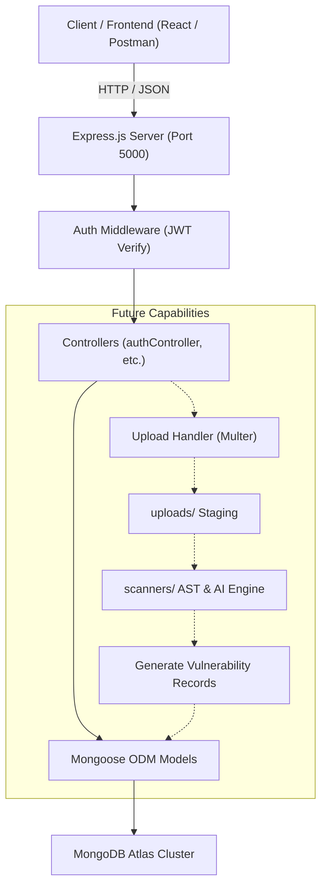
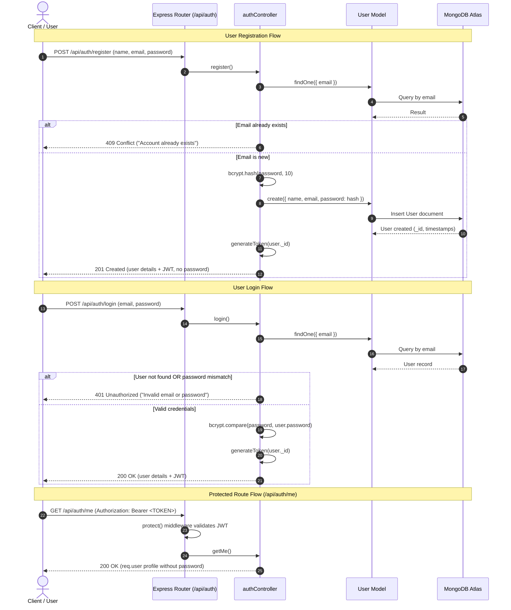
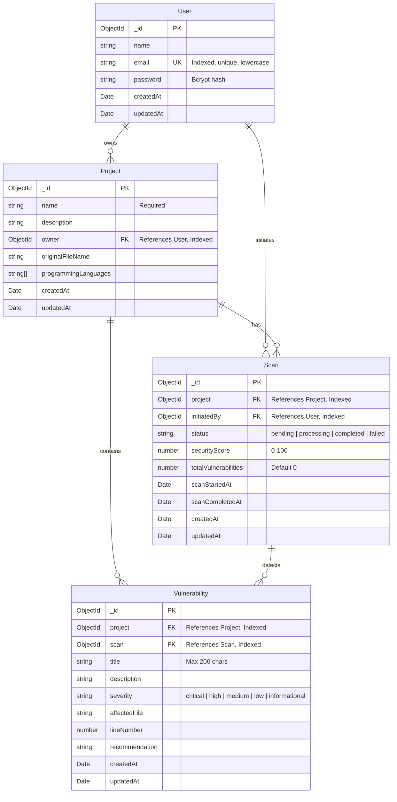

# AEGISOR

> **Intelligent Code Security Auditing and Automated Vulnerability Assessment Platform**

[](https://nodejs.org/)
[](https://www.mongodb.com/atlas)
[](https://expressjs.com/)
[](LICENSE)
[](#current-development-progress)

---

## Table of Contents

1. [Project Overview and Purpose](#1-project-overview-and-purpose)
2. [Problem Statement](#2-problem-statement)
3. [Key Features](#3-key-features)
   - [Implemented Features](#implemented-features)
   - [Planned Features](#planned-features)
4. [Technology Stack](#4-technology-stack)
5. [Complete Project Folder Structure](#5-complete-project-folder-structure)
6. [System Architecture and Workflow](#6-system-architecture-and-workflow)
7. [Frontend Documentation](#7-frontend-documentation)
8. [Backend Documentation](#8-backend-documentation)
9. [Database Architecture and Relationships](#9-database-architecture-and-relationships)
10. [API Endpoints](#10-api-endpoints)
11. [Authentication and Security Implementation](#11-authentication-and-security-implementation)
12. [AI and Security Scanning Engine](#12-ai-and-security-scanning-engine)
13. [Installation and Setup Instructions](#13-installation-and-setup-instructions)
14. [Environment Variables](#14-environment-variables)
15. [How to Run the Project Locally](#15-how-to-run-the-project-locally)
16. [Testing Instructions](#16-testing-instructions)
17. [Current Development Progress](#17-current-development-progress)
18. [Known Limitations and Pending Tasks](#18-known-limitations-and-pending-tasks)
19. [Future Roadmap](#19-future-roadmap)
20. [Team Contribution Guidelines](#20-team-contribution-guidelines)

---

## 1. Project Overview and Purpose

**AEGISOR** is an AI-powered code security and project auditing platform engineered to automate static security analysis, detect architectural and code-level vulnerabilities, enforce compliance standards, and deliver actionable remediation steps for modern development teams.

The primary purpose of AEGISOR is to empower developers and security auditors with automated, continuous project analysis. By combining traditional rule-based AST (Abstract Syntax Tree) scanning with intelligent AI-driven contextual evaluation, AEGISOR uncovers vulnerabilities early in the software development lifecycle (SDLC) before code reaches production environments.

---

## 2. Problem Statement

Modern software development moves rapidly, frequently introducing third-party dependencies, complex multi-tier architectures, and microservices. However, traditional security auditing approaches face significant hurdles:

- **Manual Code Reviews are Slow and Costly:** Security teams cannot review every pull request manually without introducing significant delivery bottlenecks.
- **High Noise-to-Signal Ratio in Traditional Scanners:** Legacy static application security testing (SAST) tools generate voluminous false positives that desensitize developers.
- **Lack of Actionable Context:** Many tools report vulnerabilities (e.g., "SQL Injection detected") without actionable code-level context or automated suggestions on how to remediate the flaw within the specific framework in use.
- **Fragmented Tooling:** Developers must juggle separate linters, secret scanners, dependency checkers, and container auditors.

**AEGISOR** solves this by offering a unified auditing platform that links projects, scans, vulnerability tracking, and intelligent remediation within an integrated interface.

---

## 3. Key Features

### Implemented Features
- **Centralized Project Repository Structure:** Clear multi-folder layout separating frontend, backend, scanners, uploads, and documentation.
- **MongoDB Atlas Integration:** Reliable, schema-enforced cloud database connection via Mongoose with asynchronous connection lifecycle handling.
- **Mongoose Data Modeling:**
  - `User`: Accounts with encrypted credentials, unique emails, and validation.
  - `Project`: Project metadata, owner relationships, and language tagging.
  - `Scan`: Lifecycle tracking for audit scans (status, duration, security score, findings count).
  - `Vulnerability`: Normalized security findings categorized by severity, affected file, line number, and remediation.
- **JWT-Based Authentication:** Stateless JSON Web Token authentication with configurable expiration.
- **Cryptographic Password Hashing:** Salted one-way hashing using `bcrypt` (10 rounds).
- **Protected Route Middleware:** Modular Bearer token verification middleware (`protect`) isolating private endpoints and stripping sensitive data.
- **Input Validation & Conflict Prevention:** Strict request validation and duplicate email rejection (`409 Conflict`).
- **Comprehensive Environment Security:** Strict `.gitignore` rules ensuring `.env` files and credentials are never checked into version control.

### Planned Features
- **Project Upload & Management API:** File upload support (`multer`) for repository zip archives and source trees into `uploads/`.
- **AST & Heuristic Security Scanners:** Static analysis engines in `scanners/` covering secret leakage, injection vulnerabilities, XSS, and misconfigurations.
- **AI-Assisted Remediation Engine:** Integration with LLM APIs to explain vulnerabilities contextually and produce copy-paste code patches.
- **Interactive Web Dashboard:** React frontend featuring audit metrics, vulnerability filters, scan progress indicators, and detailed code-inspection views.
- **Automated PDF/Markdown Audit Reports:** Exportable security compliance and audit summaries.
- **Role-Based Access Control (RBAC):** Organization, team, and auditor permissions.

---

## 4. Technology Stack

### Backend
| Technology | Version | Purpose |
|---|---|---|
| **Node.js** | `^26.x` | JavaScript runtime environment |
| **Express.js** | `^5.3.0` | HTTP application server and RESTful routing |
| **Mongoose** | `^9.12.0` | Object Data Modeling (ODM) for MongoDB |
| **JSON Web Token (`jsonwebtoken`)** | `^9.0.3` | Cryptographic session tokens for auth |
| **bcrypt** | `^6.0.0` | Cryptographic password hashing and verification |
| **dotenv** | `^18.0.9` | Environment variable management |

### Database
| Technology | Deployment | Purpose |
|---|---|---|
| **MongoDB** | MongoDB Atlas (Cloud) | Document database for users, projects, scans, and vulnerabilities |

### Frontend *(Planned)*
| Technology | Planned Role |
|---|---|
| **React.js** | Single Page Application (SPA) client interface |
| **HTML5 & CSS3 / Tailwind** | Responsive design and accessibility |
| **JavaScript (ES6+)** | Frontend application logic and API client |

### Security & Scanning *(Planned)*
| Technology | Planned Role |
|---|---|
| **AST Parsers** | Abstract Syntax Tree generation for static code analysis |
| **Pattern Matchers** | Regex-based secret detection and high-risk API signature scanning |
| **AI LLM API** | Deep contextual vulnerability auditing and remediation generation |

---

## 5. Complete Project Folder Structure

```
AEGISOR/
│
├── .gitignore                      # Root Git ignore rules (node_modules, .env, build, uploads)
├── README.md                       # Main living project documentation
│
├── backend/                        # Express & Node.js API server
│   ├── .env                        # Local environment secrets (IGNORED BY GIT)
│   ├── .env.example                # Safe environment variable template with placeholders
│   ├── .gitignore                  # Backend-specific ignore rules
│   ├── package.json                # Backend dependency definitions & scripts
│   ├── package-lock.json           # Locked dependency tree
│   ├── server.js                   # Main application entry point & HTTP listener
│   │
│   ├── config/                     # Configuration modules
│   │   └── db.js                   # Mongoose MongoDB Atlas connection handler
│   │
│   ├── controllers/                # Request handling & business logic
│   │   └── authController.js       # Register, login, and profile controllers
│   │
│   ├── middleware/                 # Custom Express middleware
│   │   └── authMiddleware.js       # JWT validation & route protection middleware
│   │
│   ├── models/                     # Mongoose data schemas
│   │   ├── Project.js              # Audited project data model
│   │   ├── Scan.js                 # Audit scan execution model
│   │   ├── User.js                 # Platform user account model
│   │   └── Vulnerability.js        # Discovered vulnerability finding model
│   │
│   ├── routes/                     # REST API route declarations
│   │   └── authRoutes.js           # Authentication endpoint mappings (/api/auth)
│   │
│   └── utils/                      # Helper & utility functions
│       └── generateToken.js        # JWT signing utility
│
├── docs/                           # Project documentation, specifications & audit guides (empty)
│
├── frontend/                       # React client application (scaffolded directory, awaiting implementation)
│
├── scanners/                       # Security scanning & rule engines (scaffolded directory, awaiting implementation)
│
└── uploads/                        # Staging area for uploaded project archives (scaffolded directory, git-ignored)
```

---

## 6. System Architecture and Workflow

### Architecture Overview



### Authentication Workflow



---

## 7. Frontend Documentation

> **Status:** Scaffolded directory (`frontend/`). No application code has been generated yet.

### Planned Architecture:
- **Framework:** React.js (SPA) with modern functional components and Hooks.
- **State Management:** Context API or lightweight state stores for auth tokens, active projects, and scan states.
- **Pages & Views:**
  - `Landing / Login / Register`: Authentication and onboarding.
  - `Dashboard`: Overview of all registered projects, overall security posture, and latest scans.
  - `Project Details`: Repository information, upload new version, view scan history.
  - `Scan Results`: Detailed vulnerability tree filtered by severity (Critical, High, Medium, Low), line-by-line code view, and remediation actions.

---

## 8. Backend Documentation

The backend is built with **Node.js** and **Express.js**, following a clean **Model-View-Controller (MVC)** architectural pattern.

- **Entry Point (`backend/server.js`):**
  - Configures environment variables via `dotenv`.
  - Initializes JSON body parsing middleware.
  - Asynchronously connects to MongoDB Atlas using `connectDB()` before binding the HTTP server listener to port `5000`.
  - Mounts routes under dedicated API namespaces (e.g., `/api/auth`).
  - Provides a root health check endpoint (`GET /`).
- **Database Connector (`backend/config/db.js`):**
  - Manages Mongoose connection states.
  - Handles fatal connection failures with descriptive logging and `process.exit(1)`.
- **Error Handling Strategy:**
  - Standardized JSON responses using `{ status: "success" | "fail" | "error", message: "...", data?: { ... } }`.
  - Graceful rejection of invalid tokens, malformed JSON, and invalid database IDs.

---

## 9. Database Architecture and Relationships

The database is powered by **MongoDB Atlas** using **Mongoose Schemas**.



### Database Indexes

| Collection | Index Fields | Purpose |
|---|---|---|
| `users` | `{ email: 1 }` (unique) | Enforces email uniqueness and optimizes login queries |
| `projects` | `{ owner: 1 }` | Rapid filtering of projects by user |
| `projects` | `{ owner: 1, createdAt: -1 }` (compound) | Sorts user's projects by newest first |
| `scans` | `{ project: 1 }`, `{ initiatedBy: 1 }` | Relationship lookups |
| `scans` | `{ project: 1, createdAt: -1 }` (compound) | Retrieves scan history for a project efficiently |
| `vulnerabilities` | `{ project: 1 }`, `{ scan: 1 }`, `{ severity: 1 }` | Fast query execution for reports |
| `vulnerabilities` | `{ scan: 1, severity: 1 }` (compound) | Filters scan findings by severity level |
| `vulnerabilities` | `{ project: 1, severity: 1 }` (compound) | Aggregates all project vulnerabilities across scans |

---

## 10. API Endpoints

### Base URL: `http://localhost:5000`

### Health Check

| Method | Endpoint | Access | Description | Status Code |
|---|---|---|---|---|
| `GET` | `/` | Public | Returns server health and operational status | `200 OK` |

### Authentication Routes (`/api/auth`)

| Method | Endpoint | Access | Description | Success Status | Error Codes |
|---|---|---|---|---|---|
| `POST` | `/api/auth/register` | Public | Registers a new user account, hashes password using bcrypt, returns JWT | `201 Created` | `400 Bad Request`<br>`409 Conflict`<br>`500 Internal Server Error` |
| `POST` | `/api/auth/login` | Public | Authenticates credentials against bcrypt hash and returns a JWT | `200 OK` | `400 Bad Request`<br>`401 Unauthorized`<br>`500 Internal Server Error` |
| `GET` | `/api/auth/me` | Private | Returns the authenticated user's profile (`req.user`) | `200 OK` | `401 Unauthorized`<br>`500 Internal Server Error` |

#### Endpoint Details

##### 1. Register User
- **URL:** `/api/auth/register`
- **Method:** `POST`
- **Headers:** `Content-Type: application/json`
- **Request Body:**
  ```json
  {
    "name": "Jane Auditor",
    "email": "jane@aegisor.com",
    "password": "SecurePassword123!"
  }
  ```
- **Validation Rules:**
  - `name`: Required, trimmed string.
  - `email`: Required, valid email pattern, converted to lowercase.
  - `password`: Required, minimum 6 characters.
- **Success Response (`201 Created`):**
  ```json
  {
    "status": "success",
    "message": "User registered successfully",
    "data": {
      "user": {
        "_id": "6af098c9fd441e391b57414c",
        "name": "Jane Auditor",
        "email": "jane@aegisor.com",
        "createdAt": "2026-11-08T15:44:09.976Z"
      },
      "token": "eyJhbGciOiJIUzI1NiIsInR5cCI6IkpXVCJ9..."
    }
  }
  ```
- **Error Responses:**
  - `400 Bad Request` (Missing fields):
    ```json
    { "status": "fail", "message": "Please provide name, email, and password" }
    ```
  - `400 Bad Request` (Invalid email format):
    ```json
    { "status": "fail", "message": "Please provide a valid email address" }
    ```
  - `400 Bad Request` (Short password):
    ```json
    { "status": "fail", "message": "Password must be at least 6 characters long" }
    ```
  - `409 Conflict` (Duplicate email):
    ```json
    { "status": "fail", "message": "An account with this email already exists" }
    ```
  - `500 Internal Server Error`:
    ```json
    { "status": "error", "message": "Internal server error during registration" }
    ```

##### 2. Login User
- **URL:** `/api/auth/login`
- **Method:** `POST`
- **Headers:** `Content-Type: application/json`
- **Request Body:**
  ```json
  {
    "email": "jane@aegisor.com",
    "password": "SecurePassword123!"
  }
  ```
- **Validation Rules:**
  - `email`: Required.
  - `password`: Required.
- **Success Response (`200 OK`):**
  ```json
  {
    "status": "success",
    "message": "Login successful",
    "data": {
      "user": {
        "_id": "6af098c9fd441e391b57414c",
        "name": "Jane Auditor",
        "email": "jane@aegisor.com",
        "createdAt": "2026-11-08T15:44:09.976Z"
      },
      "token": "eyJhbGciOiJIUzI1NiIsInR5cCI6IkpXVCJ9..."
    }
  }
  ```
- **Error Responses:**
  - `400 Bad Request` (Missing fields):
    ```json
    { "status": "fail", "message": "Please provide both email and password" }
    ```
  - `401 Unauthorized` (Invalid credentials):
    ```json
    { "status": "fail", "message": "Invalid email or password" }
    ```
  - `500 Internal Server Error`:
    ```json
    { "status": "error", "message": "Internal server error during login" }
    ```

##### 3. Get Current User Profile (Protected)
- **URL:** `/api/auth/me`
- **Method:** `GET`
- **Headers:** `Authorization: Bearer <JWT_TOKEN>`
- **Access:** Private (Protected via `authMiddleware.protect`)
- **Success Response (`200 OK`):**
  ```json
  {
    "status": "success",
    "data": {
      "user": {
        "_id": "6af098c9fd441e391b57414c",
        "name": "Jane Auditor",
        "email": "jane@aegisor.com",
        "createdAt": "2026-11-08T15:44:09.976Z",
        "updatedAt": "2026-11-08T15:44:09.976Z",
        "__v": 0
      }
    }
  }
  ```
- **Error Responses:**
  - `401 Unauthorized` (No token provided):
    ```json
    { "status": "fail", "message": "Access denied. No authorization token provided" }
    ```
  - `401 Unauthorized` (Token expired):
    ```json
    { "status": "fail", "message": "Your token has expired. Please log in again" }
    ```
  - `401 Unauthorized` (Malformed or invalid token):
    ```json
    { "status": "fail", "message": "Invalid authorization token" }
    ```
  - `401 Unauthorized` (User no longer exists in DB):
    ```json
    { "status": "fail", "message": "The user belonging to this token no longer exists" }
    ```

---

## 11. Authentication and Security Implementation

AEGISOR adheres to strict application security standards:

1. **One-Way Password Hashing:** User passwords are never saved in plaintext. They are salted and hashed using `bcrypt` with 10 salt rounds before storage in MongoDB.
2. **Protection Against Credential Leaks:** In both controller responses and middleware population, passwords are explicitly excluded (`select('-password')` or manual object projection).
3. **Stateless JWT Authorization:** Tokens carry user IDs and are cryptographically signed using a HMAC-SHA256 secret.
4. **Token Expiration:** JWTs are issued with an explicit lifetime (`7d` by default) to restrict the window of exposure.
5. **Credential Isolation:** Real credentials (`MONGODB_URI`, `JWT_SECRET`) are strictly maintained inside local `.env` files and ignored in both root and backend `.gitignore` rules.
6. **Generic Auth Error Messaging:** Login failures return generic `"Invalid email or password"` responses to prevent user enumeration attacks.

---

## 12. AI and Security Scanning Engine

> **Status:** Scaffolded directory (`scanners/`). Core scanning modules are planned for future phases.

### Planned Scanning Architecture
1. **Source Code Ingestion:** Decompress archives uploaded to `uploads/` into isolated sandboxed workspaces.
2. **Static AST Analysis:**
   - Scan JavaScript/TypeScript, Python, and other languages for known injection patterns, insecure regexes, and unsafe deserialization.
   - Detect hardcoded secrets, API keys, private keys, and connection strings.
3. **AI Contextual Analysis:**
   - Feed suspected code snippets into an LLM security auditor to verify whether a vulnerability is exploitable or a false positive.
   - Generate contextual remediation guidance and safe code refactoring examples.
4. **Result Aggregation:** Write findings as normalized documents in the `vulnerabilities` collection linked to the respective `scan` and `project`.

---

## 13. Installation and Setup Instructions

### Prerequisites
- [Node.js](https://nodejs.org/) (Version 20+ or 26+)
- [Git](https://git-scm.com/)
- A free [MongoDB Atlas](https://www.mongodb.com/atlas) cloud account (or a local MongoDB instance)

### Installation Steps

1. **Clone the repository:**
   ```powershell
   git clone <repository-url>
   cd AEGISOR
   ```

2. **Navigate to the backend directory:**
   ```powershell
   cd backend
   ```

3. **Install dependencies:**
   ```powershell
   npm install
   ```

4. **Configure environment variables:**
   - Copy the example configuration file:
     ```powershell
     cp .env.example .env
     ```
   - Open `.env` and fill in your actual credentials (see [Environment Variables](#14-environment-variables)).

5. **Whitelist your IP address in MongoDB Atlas:**
   - In MongoDB Atlas, go to **Network Access** → **Add IP Address**.
   - Whitelist your current IP address (or `0.0.0.0/0` for development).

---

## 14. Environment Variables

Store these variables in [`backend/.env`](file:///c:/Users/Asus/Desktop/AEGISOR/backend/.env). **Never commit real values to Git.**

| Variable Name | Required | Default Value | Description |
|---|---|---|---|
| `PORT` | Optional | `5000` | Port for the Express backend HTTP server |
| `MONGODB_URI` | **Required** | `mongodb+srv://<user>:<password>@<cluster>.mongodb.net/<db>?...` | MongoDB Atlas connection string |
| `JWT_SECRET` | **Required** | `random_32_byte_hex_string` | Secret key used to sign and verify JSON Web Tokens |
| `JWT_EXPIRES_IN` | Optional | `7d` | Token validity duration (e.g., `1d`, `7d`, `30d`) |

### Example Template (`backend/.env.example`)
```env
# Server Configuration
PORT=5000

# MongoDB Atlas Connection String
# Replace <username>, <password>, and <cluster-url> with your MongoDB Atlas credentials
MONGODB_URI=mongodb+srv://<username>:<password>@<cluster-url>/aegisor?retryWrites=true&w=majority

# JWT Authentication
JWT_SECRET=your_jwt_secret_key_here
JWT_EXPIRES_IN=7d
```

---

## 15. How to Run the Project Locally

### Running the Backend

From the root project directory:

```powershell
cd backend
npm run dev
```

*(Alternatively, run `npm start` for production mode).*

### Expected Startup Output
```text
[AEGISOR] MongoDB Connected successfully
[AEGISOR] Server running on port 5000
```

Verify that the server is alive by navigating to `http://localhost:5000/` in your browser. You should receive:
```json
{
  "status": "success",
  "message": "AEGISOR Backend API is running"
}
```

---

## 16. Testing Instructions

### Automated End-to-End Verification

An automated integration script is maintained in the internal scratch suite (`test_auth.js`) which runs:
1. Live MongoDB Atlas connection validation.
2. User registration (`POST /api/auth/register`).
3. Duplicate registration rejection (`409 Conflict`).
4. User login (`POST /api/auth/login`).
5. Protected route authentication (`GET /api/auth/me`).
6. Unauthenticated route rejection (`401 Unauthorized`).
7. Automatic test-record cleanup.

### Manual Testing with Postman or cURL

#### 1. Register a New User
```powershell
curl -X POST http://localhost:5000/api/auth/register `
  -H "Content-Type: application/json" `
  -d '{"name": "Developer", "email": "dev@aegisor.com", "password": "Password123!"}'
```

#### 2. Log In
```powershell
curl -X POST http://localhost:5000/api/auth/login `
  -H "Content-Type: application/json" `
  -d '{"email": "dev@aegisor.com", "password": "Password123!"}'
```

#### 3. Access Protected Route
```powershell
curl -X GET http://localhost:5000/api/auth/me `
  -H "Authorization: Bearer <INSERT_TOKEN_HERE>"
```

---

## 17. Current Development Progress

| Phase | Milestone | Status | Notes |
|---|---|---|---|
| **Phase 1** | Project Structure Initialization |  Completed | Root directories (`frontend`, `backend`, `scanners`, `uploads`, `docs`) created |
| **Phase 1** | MongoDB Atlas Connection |  Completed | Asynchronous Mongoose lifecycle, error handling, connection verified |
| **Phase 2** | Database Schemas & Models |  Completed | Models created: `User`, `Project`, `Scan`, `Vulnerability` with indexes |
| **Phase 2** | Authentication System |  Completed & Verified | Registration, Login, `protect` middleware, JWT, and bcrypt hashing fully tested against live Atlas |
| **Phase 3** | Project Management & File Uploads | ⏳ Pending | `multer` upload support for zip files into `uploads/` and Project CRUD API |
| **Phase 4** | Static Security Scanning Engine | ⏳ Pending | AST parsing & regex pattern matching in `scanners/` |
| **Phase 5** | AI Remediation Engine | ⏳ Pending | Integration with LLM APIs for automated remediation advice |
| **Phase 6** | Frontend Web Dashboard | ⏳ Pending | React interface for managing projects and reviewing scan reports |
| **Phase 7** | Audit Report Generation | ⏳ Pending | PDF/Markdown report export functionality |

### Phase 2 Authentication Verification Matrix

| Test Case | Method & Route | Expected Status | Result |
|---|---|---|---|
| User Registration | `POST /api/auth/register` | `201 Created` |  PASS (User saved, bcrypt hashed, JWT returned) |
| Duplicate Registration Prevention | `POST /api/auth/register` | `409 Conflict` |  PASS (Rejects existing email with descriptive error) |
| User Login (Valid Credentials) | `POST /api/auth/login` | `200 OK` |  PASS (Verified password against hash, fresh JWT issued) |
| User Login (Invalid Password) | `POST /api/auth/login` | `401 Unauthorized` |  PASS (Generic invalid credentials response) |
| Protected Profile Access (With Token) | `GET /api/auth/me` | `200 OK` |  PASS (Bearer token verified, password hash omitted) |
| Protected Profile Access (No Token) | `GET /api/auth/me` | `401 Unauthorized` |  PASS (Access denied due to missing token) |
| Atlas Cleanup | `User.findByIdAndDelete` | Clean DB |  PASS (Ephemeral test user removed from database) |

---

## 18. Known Limitations and Pending Tasks

- **File Uploads Not Yet Implemented:** The `uploads/` folder exists, but endpoints to accept zip archives or multi-file uploads are pending.
- **Scanning Engine Not Yet Implemented:** The `scanners/` module currently contains no scanner rules or AST parsers.
- **Frontend Unimplemented:** The `frontend/` directory is scaffolded but contains no React application yet.
- **Password Reset / Email Verification:** Currently, users register and login directly; email verification and password reset flows are planned for future revisions.

---

## 19. Future Roadmap

```
[Phase 1 & 2: Setup, DB & Auth]  ---> COMPLETED
          │
          ▼
[Phase 3: Project Management & File Uploads]
  • Multer integration for zip archives
  • Project CRUD routes (/api/projects)
  • Storage organization inside uploads/
          │
          ▼
[Phase 4: Security Scanner Engine]
  • Language-specific AST parsing (JS, TS, Python)
  • Secret and credential leak detection
  • Known CVE and OWASP Top 10 rule engine
          │
          ▼
[Phase 5: AI Vulnerability Remediation]
  • LLM contextual code analysis
  • Automated patch generation
          │
          ▼
[Phase 6: React Frontend Interface]
  • Interactive vulnerability dashboards
  • Live scan progress indicators
          │
          ▼
[Phase 7: Reporting & CI/CD Integrations]
  • PDF/Markdown export
  • GitHub Actions / CI/CD scanning integration
```

---

## 20. Team Contribution Guidelines

1. **Branching Strategy:**
   - Create topic branches from `main`: `git checkout -b feature/your-feature-name` or `fix/your-fix-name`.
2. **Environment Variables:**
   - Never commit `.env` or sensitive credentials.
   - If adding a new environment variable, document it in `backend/.env.example` and update this `README.md`.
3. **Commit Standards:**
   - Use clear commit messages: `feat: implement project upload endpoint`, `fix: handle expired JWT gracefully`.
4. **Mandatory Documentation Update:**
   - Any commit modifying architecture, endpoints, models, or environment variables **must** update the corresponding sections of this `README.md`.
